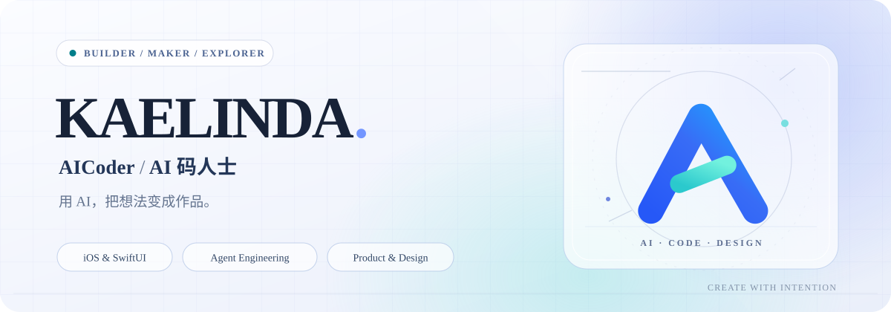

  <picture>
    <source media="(prefers-color-scheme: dark)" srcset="./assets/hero-dark.svg">
    <source media="(prefers-color-scheme: light)" srcset="./assets/hero-light.svg">
    
  </picture>

**用 AI，把想法变成作品。**

iOS Developer · AI & Agent Builder · Product-minded Maker

[代表项目](#selected-work) · [正在探索](#what-im-exploring) · [AI 编程指南](https://github.com/kaelinda/aicoding-guide-book)

 

你好，我是 **Kaelinda**，也在打造技术创作者品牌 **AICoder / AI 码人士**。

我关注的不只是“AI 能生成什么”，更关心**如何把想法变成可运行、可验证、可交付的产品**。从原生 iOS 体验到多 Agent 协作，从工具链到产品设计，持续动手、迭代并分享过程。

## Selected Work

<table>
  <tr>
    <td width="50%" valign="top">
      01 · AGENT INFRASTRUCTURE
      <h3><a href="https://github.com/kaelinda/content-dashboard">Content Hub ↗</a></h3>
      
为多 Agent 构建的私有内容数据中枢：统一来源、版本、不可变产物与发布台账。

      Next.js · TypeScript · PostgreSQL · MCP
    </td>
    <td width="50%" valign="top">
      02 · APP CRAFT
      <h3><a href="https://github.com/kaelinda/print-assistant-ios">Print Assistant ↗</a></h3>
      
原生 iOS 文档扫描与打印工具：OCR、PDF 处理、证件照和身份证 A4 排版。

      SwiftUI · VisionKit · Vision · PDFKit
    </td>
  </tr>
  <tr>
    <td width="50%" valign="top">
      03 · KNOWLEDGE SHARING
      <h3><a href="https://github.com/kaelinda/aicoding-guide-book">AI Coding Guide Book ↗</a></h3>
      
为 iOS 开发者整理的 AI 编程实践路径：从工具入门，到 Agent、MCP 与协作工作流。

      AI Coding · iOS · Developer Education
    </td>
    <td width="50%" valign="top">
      04 · CREATOR WORKFLOW
      <h3><a href="https://github.com/kaelinda/content-gen-skills">Content Gen Skills ↗</a></h3>
      
Codex / Claude Code 共用的内容生产 Skill：资料采集、中文质检、主题渲染与封面生成。

      Agent Skills · Python · Publishing
    </td>
  </tr>
</table>

## What I'm Exploring

**AI Engineering** — Agent workflows, tool calling, MCP, safe automation and repeatable evaluations.

**Apple Platforms** — SwiftUI, thoughtful interactions, accessibility and native application craft.

**Product & Design** — Small, useful products with clear information hierarchy and refined details.

## Principles

> **Make it useful. Make it understandable. Make it real.**
>
> 先定义问题，再验证方案。重视可复现的流程、诚实的边界，以及可交付的代码。

  Explore the code · Learn by building · Keep refining
    
  <a href="https://github.com/kaelinda/aicoder"><b>AICoder Project</b></a>
  &nbsp; · &nbsp;
  <a href="https://github.com/kaelinda?tab=repositories"><b>All Repositories</b></a>

